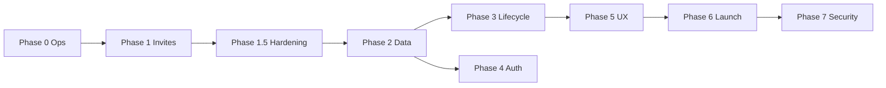
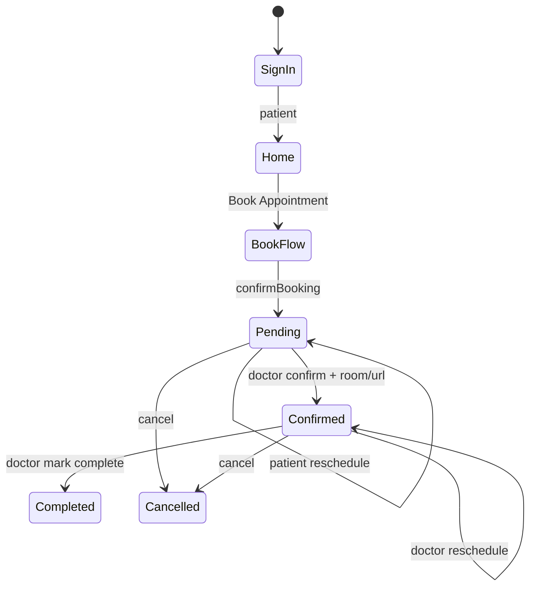

# Pre-deployment gap implementation plan

**Target:** Web pilot (Supabase + hosted web)  
**Decisions locked in:**

- Doctors: admin creates invites in-app; doctor claims invite code after account exists.
- Telehealth / rooms: doctor sets video URL and room when confirming; home visits capture address at booking.
- **Multiple pending bookings:** Allowed — a patient may have more than one unconfirmed appointment at a time (no cap in v1).
- **Doctor reschedule:** Doctor-initiated reschedule may set or keep `confirmed` (doctor authority). **Patient** reschedule must **never** promote `pending` → `confirmed`.

**Out of v1 (web pilot):** EAS, App Store, Play Store, avatar uploads (unless a quick win is needed later).

---

## Issue registry (all identified gaps)

| ID | Area | Issue | Solution | Phase |
|----|------|--------|----------|-------|
| I-01 | Schema / ops | Migrations not documented; README still says mocks | RUNBOOK + README rewrite + ordered migrations | 0 |
| I-02 | Ops | Empty DB — no doctors/slots | Optional `seed_pilot.sql` + RUNBOOK smoke test | 0 |
| I-03 | Onboarding | `doctor_invites` + RPC unused | Admin invite UI + doctor claim flow | 1 |
| I-04 | Auth | No forgot password | `(auth)/forgot-password.tsx` + Supabase redirect URLs | 4 |
| I-05 | Admin | No `is_active` toggle | Admin deactivate/reactivate profiles | 4 |
| I-06 | Avatars | `avatar_url` + bucket unused | Defer post-pilot | — |
| I-07 | Booking | Placeholder telehealth URL at patient confirm | Leave `video_url` null until doctor confirm sheet | 2 |
| I-08 | Booking | Home visit type without `appointments.address` | Required address on intake + persist | 2 |
| I-09 | UX | Pending vs confirmed indistinguishable | Status chips from `dbStatus` on cards + Home | 2 |
| I-10 | Doctor | Confirm without room/URL | Confirm sheet (room / video URL / read-only address) | 2 |
| I-11 | Lifecycle | No `completed` in app | Doctor “Mark complete” on agenda | 3 |
| I-12 | Lifecycle | Past tab relies on time only | Keep filters; ensure `completed` maps in mappers | 3 |
| I-13 | **Process** | **Patient reschedule sets `confirmed` for pending visits** | `rescheduleAppointment`: preserve `pending` when manager is patient; doctor path unchanged | **1.5** |
| I-14 | **Process** | **Persisted booking draft + expired hold after reload** | Book stack guard: validate hold on mount; clear draft + redirect if expired | **1.5** |
| I-15 | **Process** | **Sign-out leaves hold in localStorage** | `resetBookingDraft()` + `releaseHold` on sign-out | **1.5** |
| I-16 | **Process** | **Abandoned booking keeps slot held until TTL** | `releaseHold(slotId)` on book stack abandon / explicit “Release slot” | **1.5** |
| I-17 | **Process** | **Duplicate `self` beneficiaries** | Service guard + optional DB unique index | **1.5** |
| I-18 | **Process** | **Returning 3-tap skips doctor accepting check** | Re-fetch doctor; block with message if not accepting | **1.5** |
| I-19 | **Process** | **`ensureSelfBeneficiary` only on sign-in** | Also run after `getCurrentSession` bootstrap for patients | **1.5** |
| I-20 | **Process** | **Stale Zustand session (role/name)** | Re-resolve `profiles` on bootstrap; update session store | **1.5** |
| I-21 | Concurrency | Hold upsert may overwrite another user’s hold | v1: document; post-pilot: RPC `hold_slot_if_available` | 5 / 7 |
| I-22 | Security | Broad RLS “authenticated update slots” | Document in RUNBOOK; tighten policy or RPC in post-pilot | 5 / 7 |
| I-23 | UX | Add dependent auto-selects them for booking | Confirm dialog: “Book for [name] now?” vs “Add only” | 5 |
| I-24 | UX | Flat slot list | Group by date on `book/slot` + reschedule sheet | 5 |
| I-25 | UX | No book-flow step indicator | Stepper: Doctor → Time → Details → Confirm | 5 |
| I-26 | UX | Hold countdown only on slot screen | Sticky hold banner across `/book/*` | 5 |
| I-27 | UX | Confirm summary missing beneficiary | Show beneficiary on confirm + success screens | 5 |
| I-28 | UX | Dev copy on confirm (“Returning path…”) | Remove or a11y-only hint | 5 |
| I-29 | UX | Returning path hides visit type change | Home subtitle + “Change doctor or visit type” → standard flow | 5 |
| I-30 | Doctor UX | Empty agenda | CTA → Schedule tab | 5 |
| I-31 | Doctor UX | Pending not visible on agenda cards | Amber “Needs confirmation” + count on today | 5 |
| I-32 | Doctor UX | Reason/notes hidden | Collapsible reason/notes on visit cards | 5 |
| I-33 | Admin UX | Roster lacks at-a-glance capacity | Next slot / accepting badge per doctor | 5 |
| I-34 | Admin UX | Appointments list unfiltered | Filter: today / pending / confirmed | 5 |
| I-35 | Polish | Artificial 550ms latency in prod | Env-driven `schedulingLatencyMs` | 5 |
| I-36 | Polish | Cannot delete future blackouts | Delete blackout + revert safe slots | 5 |
| I-37 | Email | Sign-up without session skips self beneficiary | Metadata + ensureSelf on sign-in/bootstrap (I-19); setup self sheet | 1.5 |
| I-38 | a11y | Pending→confirmed not announced | `announceForAccessibility` on Visits refresh when status changes | 5 |

---

## Phase 0 — Ops baseline (0.5 day)

**Goal:** Anyone can deploy a fresh Supabase project without guessing.

| Task | Deliverable | Issues |
|------|-------------|--------|
| Rewrite `README.md` | Live Supabase, env vars, migration order, quality scripts | I-01 |
| Add `docs/RUNBOOK.md` | Admin user, migrations, doctor bootstrap, smoke test | I-01, I-02 |
| Migration checklist | `schema.sql` → `20260318_*` → `20260319_*` → `20260320_*` → invites (skip if duplicate) | I-01 |
| Optional seed SQL | `supabase/seed_pilot.sql` (commented templates) | I-02 |
| RUNBOOK security note | Document I-21, I-22 for pilot operators | I-21, I-22 |

**Acceptance:** New engineer follows RUNBOOK and completes one booking on web.

---

## Phase 1 — Doctor onboarding (2–3 days)

**Goal:** No SQL required for routine doctor setup. **Issues:** I-03

### 1.1 Admin: doctor invites

**UI:** Section on **Roster** — “Invite doctor”.

**Fields:** email (reference), specialty, optional bio, fee, years, expiry (default 7 days).

**Backend:**

- `lib/services/invites.ts`: `createDoctorInvite`, `listDoctorInvites`, `revokeDoctorInvite`
- Insert `doctor_invites` with generated code (8-char uppercase), `created_by`, `status = pending`

**Recommendation:** Copy button for code; no in-app email in v1.

### 1.2 Doctor: claim invite

**UI:** Patient **Profile** (or dedicated route): “Clinician? Enter invite code”.

**Flow:** RPC `claim_doctor_invite` → refresh session from `profiles` → redirect `/agenda`.

**Copy:** Invite email is informational in v1 (no match enforcement).

**Acceptance:** Admin invite → user signs up → claims → Agenda + Schedule work.

---

## Phase 1.5 — Process hardening (airtight flows) (1–1.5 days)

**Goal:** Booking, session, and reschedule logic cannot bypass business rules. **Do before Phase 6 smoke test.**

### 1.5.1 Reschedule status (I-13)

**File:** `lib/services/scheduling.ts` — `rescheduleAppointment`

- Read current `appointment.status` before update.
- If manager is **patient** and status is `pending`, keep **`pending`** after reschedule.
- If manager is **doctor**, set **`confirmed`** (or preserve `confirmed` if already confirmed).
- Do not clear `room` / `video_url` unless product rule says reset on reschedule (default: preserve).

**Tests:** Manual — pending patient reschedule → still pending on doctor agenda.

### 1.5.2 Hold lifecycle (I-14, I-15, I-16)

**New service methods:**

- `releaseHold(slotId: string)` — delete `slot_holds` row; set slot `available` if status is `held` and caller owns hold.
- `validateHold(slotId, hold)` — optional lightweight read for book stack.

**Sign-out:** `ShellHeader` → after `signOut`, call `resetBookingDraft()`; if draft had `slotId` + `hold`, call `releaseHold` (best-effort).

**Book layout guard:** `app/(patient)/book/_layout.tsx` (or hook `useBookingHoldGuard`):

- On focus/mount: if `hold` present and expired → clear draft, toast/redirect Home with “Hold expired”.
- If `hold` valid but server disagrees → clear + redirect to `/book/slot`.

**Abandon UX (I-16):** Sticky banner “Release slot” calls `releaseHold` + clear slot fields in store.

### 1.5.3 Self beneficiary integrity (I-17)

- `createBeneficiary`: if `relationship === 'self'`, reject when self already exists for account.
- Optional migration: `CREATE UNIQUE INDEX ... ON beneficiaries (account_holder_id) WHERE relationship = 'self'`.

### 1.5.4 Returning booking guard (I-18)

**File:** `app/(patient)/index.tsx` — `handleBookAppointment` returning branch:

- Load doctor from `listDoctors()` or cache; if `!isAcceptingBookings`, announce + stay on Home (or open doctor picker).

### 1.5.5 Session bootstrap (I-19, I-20)

**File:** `lib/services/auth.ts` + `components/auth-bootstrap.tsx`

- After successful `getCurrentSession`, always re-fetch profile (already in `resolveAppSession`) and **overwrite** persisted session in store.
- If role is patient, call `ensureSelfBeneficiary` (same as sign-in).

**Acceptance checklist:**

- [ ] Patient reschedules pending visit → still pending
- [ ] Sign out during booking → slot released (after TTL max 5 min if release fails)
- [ ] Reload on confirm with expired hold → sent Home with message
- [ ] Cannot create second self beneficiary
- [ ] Returning book blocked when doctor not accepting
- [ ] Cold start repairs self beneficiary when metadata exists

---

## Phase 2 — Booking data completeness (2 days)

**Goal:** Operational truth for pending, telehealth, home visit. **Issues:** I-07–I-10

### 2.1 Pending vs confirmed (I-09)

| Surface | Change |
|---------|--------|
| `VisitCard` | Prop or derive label: `pending` → “Awaiting confirmation”, `confirmed` → “Confirmed” |
| Home upcoming card | Same |
| `confirmation.tsx` success | Keep “Booking submitted” + link to My Visits |

### 2.2 Home visit address (I-08)

| Layer | Change |
|-------|--------|
| `book/intake.tsx` | Required address when `home-visit`; prefill from profile |
| `lib/stores/booking.ts` | `visitAddress?: string` |
| `confirmBooking` | Write `appointments.address` |
| Visits / cards | Show address for home visits |

### 2.3 Doctor confirm sheet (I-07, I-10)

**UI:** Agenda **Confirm** opens sheet:

- In-clinic: room (required)
- Telehealth: video URL (required, URL validate)
- Home visit: show address; optional confirm note

**Backend:** `confirmDoctorAppointment(id, { room?, videoUrl? })` — update fields then `status = confirmed`.

**Patient path:** Remove placeholder telehealth URL from `confirmation.tsx` insert.

**Acceptance:** Telehealth join only after doctor confirm; no fake URL at book time.

---

## Phase 3 — Visit lifecycle (1–1.5 days)

**Goal:** Completed visits and Past tab without SQL. **Issues:** I-11, I-12

### 3.1 Mark complete (I-11)

- Service: `completeDoctorAppointment(appointmentId)` → `status = completed`
- UI: Agenda — “Mark complete” for confirmed visits on or before today (not pending)

### 3.2 Filters (I-12)

- Verify `mapDbAppointmentStatus` / Past tab include `completed`
- Proxy tab: optionally hide cancelled (product: keep for audit)

**Acceptance:** Doctor completes → patient Past shows completed.

---

## Phase 4 — Account & admin hygiene (1 day)

**Issues:** I-04, I-05

### 4.1 Deactivate users (I-05)

Admin UI: toggle `profiles.is_active` (not self). Already enforced on login.

### 4.2 Forgot password (I-04)

`(auth)/forgot-password.tsx` + link from sign-in; configure Supabase redirect URLs for web host.

**Defer:** Avatars (I-06).

---

## Phase 5 — UX/UI + production polish (1.5–2 days)

**Goal:** Clarity, booking polish, operator tools. **Issues:** I-23–I-36, I-38

### 5.1 Booking UX (I-24–I-29)

| Item | Implementation |
|------|----------------|
| Date-grouped slots | SectionList / headers by `yyyy-MM-dd` on slot + reschedule |
| Step indicator | Shared `BookingStepHeader` in book stack |
| Hold banner | `book/_layout.tsx` — countdown + release (ties I-16) |
| Beneficiary on confirm | Pull name from beneficiaries using `beneficiaryId` |
| Remove dev copy | Drop visible “Returning path…” on confirm |
| After add dependent | Alert/sheet: book for them now vs add only (I-23) |
| Returning path | Home line: “With Dr X · [type]” + link to standard flow (I-29) |

### 5.2 Doctor & admin UX (I-30–I-34)

| Item | Implementation |
|------|----------------|
| Empty agenda CTA | Link to Schedule |
| Pending badge | Count on today + card styling |
| Reason/notes | Collapsible on `DoctorVisitCard` |
| Roster enrichment | Accepting flag + next available slot |
| Admin appointments filter | Segmented: All / Today / Pending / Confirmed |

### 5.3 Production config (I-35, I-36)

- `schedulingLatencyMs` from `EXPO_PUBLIC_SCHEDULING_LATENCY_MS` (default 550 dev, 0 prod)
- `deleteBlackout(id)` + restore overlapping slots to `available` where safe

### 5.4 Accessibility (I-38)

- On Visits load, if any visit flipped pending→confirmed since last visit, announce once (optional lightweight store timestamp)

---

## Phase 6 — Web pilot launch (0.5 day)

| Task | Notes |
|------|--------|
| Web export | `npx expo export --platform web` + static host |
| Env | Prod Supabase URL/anon key |
| Supabase Auth | Site URL, redirects, email templates |
| Smoke test | Full matrix below |

---

## Phase 7 — Post-pilot security (optional, after public traffic)

**Issues:** I-21, I-22

| Item | Solution |
|------|----------|
| Hold race | Postgres RPC: hold only if `status = 'available'` OR `held_by = auth.uid()` |
| Slot updates | Replace broad UPDATE policy with RPCs for hold/book/release |
| Audit | Log admin invite + deactivate actions (table or Supabase logs) |

---

## Suggested build order

**Recommended implementation order:**

1. Phase 0  
2. Phase **1.5** (can start parallel with Phase 1 after 1.5.3–1.5.5)  
3. Phase 1  
4. Phase 2 → 3 → 4 → 5 → 6  

Phase **1.5** should complete before calling booking “pilot-ready.”

---

## Open questions (defaults locked)

| Question | Decision |
|----------|----------|
| Invite email must match account? | No in v1 |
| Admin confirms appointments? | Defer; doctors only |
| Multiple pending bookings? | Yes |
| Patient reschedule pending → ? | Stay **pending** |
| Doctor reschedule pending → ? | **Confirmed** (doctor authority) |
| Reset room/URL on reschedule? | Preserve unless confirm sheet re-run |

---

## Effort summary

| Phase | Estimate |
|-------|----------|
| 0 Ops | 0.5 d |
| 1 Invites | 2–3 d |
| **1.5 Hardening** | **1–1.5 d** |
| 2 Booking data | 2 d |
| 3 Lifecycle | 1–1.5 d |
| 4 Account | 1 d |
| 5 UX + polish | 1.5–2 d |
| 6 Launch | 0.5 d |
| 7 Security (optional) | 1–2 d |
| **Total (through launch)** | **~10–12 dev days** |

---

## Verification matrix (before go-live)

### Ops & onboarding
- [ ] Migrations applied (I-01)
- [ ] RUNBOOK smoke test passes (I-02)
- [ ] Admin creates invite; doctor claims (I-03)

### Process hardening (Phase 1.5)
- [ ] Pending patient reschedule stays pending (I-13)
- [ ] Expired persisted hold clears on book entry (I-14)
- [ ] Sign-out clears draft and releases hold (I-15)
- [ ] Release slot works from book banner (I-16)
- [ ] Single self beneficiary enforced (I-17)
- [ ] Returning book respects accepting flag (I-18)
- [ ] Bootstrap ensures self + fresh profile (I-19, I-20)

### Booking data (Phase 2)
- [ ] Pending vs confirmed labels (I-09)
- [ ] Home address saved and shown (I-08)
- [ ] Doctor confirm sets room/URL; no placeholder at patient submit (I-07, I-10)

### Lifecycle (Phase 3)
- [ ] Mark complete → Past (I-11, I-12)

### Account (Phase 4)
- [ ] Forgot password on web (I-04)
- [ ] Admin deactivate blocks login (I-05)

### UX (Phase 5 — spot check)
- [ ] Slot grouping + stepper + hold banner (I-24–I-26)
- [ ] Add-dependent confirmation (I-23)

### End-to-end smoke
- [ ] Patient book → pending → doctor confirm → telehealth join window → complete
- [ ] `typecheck` + `lint` clean; web export on production URL

---

## Flow reference (target state after plan)

